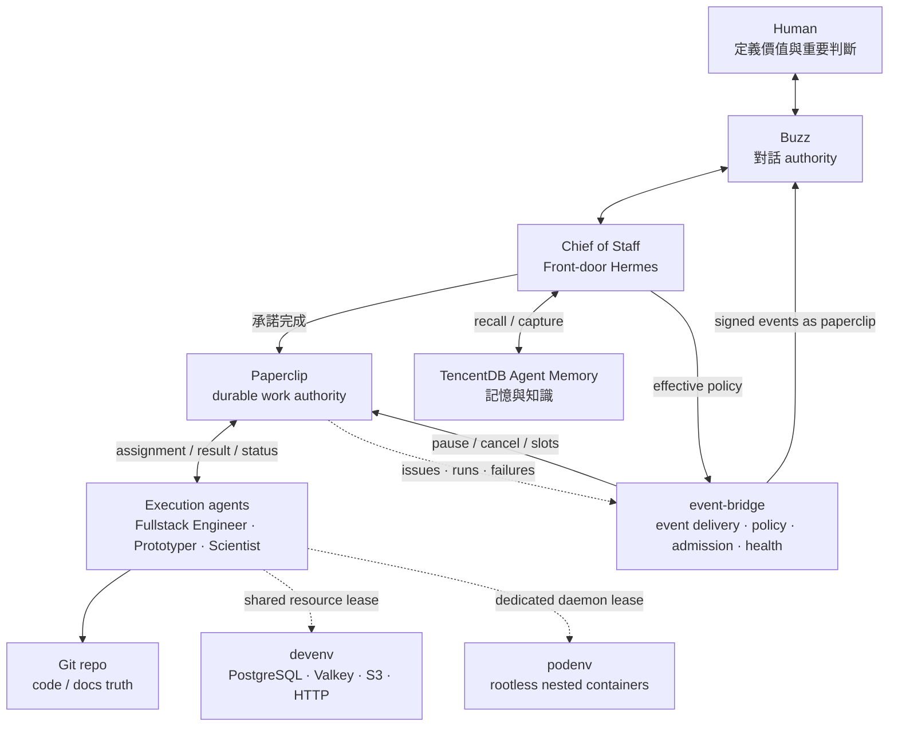

# OPC Stack

OPC Stack 是為單一操作者設計的 Docker Compose agent company runtime，整合對話入口、工作控制面、執行 agents、開發資源與長期記憶。你大部分時間只需要和 **Chief of Staff** 對話；它會保留上下文、判斷需求該去哪裡，並協調其他 agents。

核心規則是「一個概念只有一個 durable writer authority」：Buzz 擁有對話、Paperclip 擁有可追蹤工作、TencentDB 保存供 reasoning 使用的記憶與知識，而程式碼與文件的事實來源是 Git repo。

## 心智模型

日常流程不是由人逐一管理 agents，而是：

1. Human 透過 Buzz（或 Hermes dashboard）和 **Chief of Staff** 對話。
2. Chief of Staff 判斷內容應該消失、存成記憶，或成為必須完成的工作；它負責分流，不自己實作。
3. 必須完成的工作會成為 Paperclip issue，再依性質指派給 engineering、prototype 或 research lane。
4. 執行 agent 將結果與狀態寫回 Paperclip；需要保留的程式碼與文件進 Git。記憶只提供 reasoning context，不會取代人的授權或 Paperclip 的工作狀態。
5. Paperclip 的工作事件（完成／阻塞／取消／run 失敗）由 **event-bridge** 以獨立的 `paperclip` 身分送回 Buzz 的原始 thread；Chief of Staff 被喚醒後**回 Paperclip 查證**，再依已授權的 mandate 決定回報、繼續、開後續票或問人。資源與暫停由 OPC policy 在程式層把關，不靠 prompt。

### Agents

| Agent | Runtime | 職責 |
|---|---|---|
| **Chief of Staff** | Front-door Hermes | 主要對話窗口；掌握上下文、判斷意圖、建立與分派工作，但不自己實作 |
| **Fullstack Engineer** | OMP | Durable production coding agent；負責端到端實作要長期保留的功能、bug fix、既有 issue 與 PR |
| **Prototyper** | OMP | Prototype lane；用最小、可檢視且具名的 preview artifact 快速驗證產品方向 |
| **Scientist** | Hermes expert profile | Research lane；用可丟棄的實驗產生證據與 backlog 建議，不直接交付 production code |

兩個 coding agents 是負責 durable production implementation 的 **Fullstack Engineer**，以及負責 prototype lane 的 **Prototyper**；**Scientist** 則是跑在 Hermes gateway 裡、具獨立身分與常駐 devenv 租約的 research lane。

另有一個**不是 agent** 的服務身分 `paperclip`：只負責張貼系統事件與健康告警，沒有 ACP runtime、不加入頻道、也不出現在 agent directory。

## 架構



## 服務

| 服務 | 說明 | port |
|---|---|---|
| `buzz` | Nostr relay(+ pg/redis/minio) | 3000 |
| `frontdoor` | buzz-acp → `hermes acp`(與 buzz 共用 netns) | — |
| `hermes` | gateway API server (dashboard 關閉) | 8642 |
| `hermes-dashboard` | web dashboard over the buzz front door's hermes home (sessions + live logs/thinking) | 9119 |
| `paperclip` | canonical work control plane | 3100 |
| `event-bridge` | Paperclip→Buzz 的事件投遞、policy / mandate、admission（含硬鎖）、run 健康監控；無對外 port | — |
| `devenv-pg` / `devenv-valkey` / `devenv-s3` | agent 共用、租戶隔離的 PostgreSQL/pgvector、Valkey 與 S3 | 5433 / 6380 / 9002（僅 localhost） |
| `podenv` | rootless Podman daemon，提供巢狀容器租約 | 23000–23015（僅 localhost） |
| `tencentdb-core` / `-hub` / `-proxy` | memory gateway / panel+knowledge / LLM proxy | 8420 / 8125+8424 / 8096 |

LLM 全棧預設使用 OpenCode Go(`https://opencode.ai/zen/go/v1`),`.env` 填 `OPENAI_API_KEY` 一個 key 即可。`OPENAI_BASE_URL` 控制 OpenAI-compatible endpoint;shared gateway/dashboard/Paperclip/TencentDB 的模型用 `OPENAI_MODEL`（預設 `deepseek-v4.1-flash`）,frontdoor relay 則用 `BUZZ_AGENT_MODEL`（預設 `deepseek-v4.1-flash`）。Hermes custom provider runtime 讀 key/base URL,模型以 `config.yaml` 為 source of truth。Hermes 的記憶走官方 `memory_tencentdb` provider,直連 `tencentdb-core`。

## 事件與自主權控制

執行完成後不是「通知一聲就結束」，而是一個閉環：`event-bridge`（獨立服務、獨立身分）把 Paperclip 的 issue/run 事件可靠地送回 Buzz，Chief of Staff 查證後才決定下一步。

- **事件**：完成的 ticket、blocked/cancelled、run 失敗、健康異常都以版本化事件送出（`opc-event` tag + 去重 id）；私有頻道不可達時走 fallback，不會靜默遺失。
- **自主權**：`Execution Mandate` 決定 Hermes 能自主做什麼（style、可否開後續票、期限、預算）；優先序是 hard safety > operator override > mandate > adaptive > default。
- **資源與控制**：Core = engineering agent，Lab = Prototyper + Scientist。`Lab 0%` 以 Paperclip 原生的 agent pause 實作（新工作進不來、進行中的跑完、重啟後仍有效）；非零配比會依近一小時的實際 run 時數緩慢自適應，但永不覆寫 operator 的設定，也永不把任一軌調到 0。
- **人永遠有最終控制**：強制終止需要 owner 在 `#opc-control` 頻道簽名的指令；健康監控只告警，**不會**自動終止任何 run。

```bash
docker compose exec event-bridge python3 -m opc_bridge.cli state          # 配比、控制狀態、adaptive 量測
docker compose exec event-bridge python3 -m opc_bridge.cli policy --track lab
docker compose exec event-bridge python3 -m opc_bridge.cli events --limit 20
```

操作細節（`!opc` 指令文法、控制頻道、升級步驟）見 `SETUP.md`；設計與限制見 `docs/superpowers/specs/2026-11-04-event-autonomy-control-design.md`。

## 開發資源租約

### devenv

`devenv` 提供 agent 可直接使用、但彼此隔離的開發資源。預設租約會建立獨立的 PostgreSQL/pgvector database 與 Valkey ACL user；也可用 `--with` 選擇 `postgres`、`valkey`、`http`、`s3`，並將對應的連線變數寫入 workspace 的 `.env`。適合一般應用程式開發；agent 不需要也拿不到 host Docker。

```bash
docker compose exec -u node paperclip devenv provision demo --env-file /tmp/demo.env
docker compose exec paperclip devenv list          # 查看租約與用量
docker compose exec paperclip devenv release demo  # 手動刪除租約及資料
```

PostgreSQL 與 Valkey 也分別發佈在 host 的 `127.0.0.1:5433`、`127.0.0.1:6380`，可用租約輸出的憑證從 SQL/Valkey client 直接連線。租約不會自動回收。

### podenv

`podenv` 用 rootless Podman 在隔離的 service container 內提供 daemon 租約，適用於無法共享多租戶的服務，或只能以 image 取得的指定舊版本，例如 MySQL 5.7。PostgreSQL、pgvector、Valkey、Redis 家族預設會被導向 `devenv`；確實需要獨立或舊版 instance 時，必須用 `--dedicated` 記錄原因。

```bash
docker compose exec paperclip podenv provision legacy-erp --image mysql:5.7 --port 3306 \
  --as MYSQL_URL --env-file /tmp/legacy-erp.env
docker compose exec paperclip podenv list
docker compose exec paperclip podenv release legacy-erp  # 唯一回收路徑，連資料一起刪除
```

每個租約會取得 host port 與連線變數；資料會跨 stack restart 保留，但沒有自動 GC 或個別磁碟配額。完整選型、參數與限制見 `SETUP.md`，隔離與操作不變量見 `AGENTS.md`。

## 快速開始

```bash
scripts/setup.sh              # 新機器一鍵: .env → submodule init → prepare → build → up
scripts/prepare.sh            # patches/ → upstream/ 同步(改 patch 後、build 前必跑)
docker compose up -d --build  # 啟動/重建
tests/connectivity.sh          # 連通性測試(不碰 LLM)
docker compose logs -f <svc>  # 看日誌
```

改動一律改 `patches/<proj>/`,不直接改 `upstream/`(git submodule,乾淨 checkout)。

## 換 LLM endpoint / 模型

`.env` 的三個值是全棧唯一 source of truth：`OPENAI_API_KEY`、`OPENAI_BASE_URL`、`OPENAI_MODEL`（model id 用 endpoint 自己的寫法，例如 `deepseek-v4.1-flash` 或 `deepseek/deepseek-v4.1-flash`）。安裝新版 reconcile 後，換模型只需 `docker compose up -d`，不需要 rebuild；dashboard／`/model` 或手改的 provider 設定會保留。舊 volume 若有無法判定歸屬、且與 Compose 不同的憑證，會保留原 endpoint 並警告；一次性對齊指令見 `SETUP.md` → 「Existing installation」。`BUZZ_AGENT_MODEL` 留空 = 跟 `OPENAI_MODEL`。其餘細節見 `SETUP.md` → 「LLM provider」。

## 使用 tailnet domain（手機 app）

Buzz 手機 app 的加入流程要求 TLS（`wss://` / `https://`），並拒絕 `100.64.0.0/10` 的 IP 字面值，所以只給 tailnet IP 會連不上。`tailscale serve` 可在 `https://<machine>.<tailnet>.ts.net` 終止 TLS 並反代到 relay；此時有四個要點：

- **host 要一起換**：`BUZZ_RELAY_URL` 與 `communities.host` 必須同時改成該 domain（`communities.host` 是純 domain、不帶 `:443`）。只改 host、保留同一列 UUID，既有對話／頻道／成員才會留著；換成不同字串等於新 community。
- **canonical host 只有一個**：舊 client 必須重新加入（用 `https://<domain>/invite/<code>`）；invite claim 會一併補上 relay membership。
- **狀態在 host、不在 compose**：`tailscale serve --bg` 會持久化（重開機仍在），但換機器要重跑。
- **容器連不到 443 的坑**：serve listener 預設綁在 `tailscale0` interface，frontdoor／hermes／event-bridge 走 docker bridge 會得到 `connection refused`，frontdoor 因而 crash-loop、agent 不回話。在 host 的 `/etc/default/tailscaled` 加 `TS_SERVE_ALLOW_ALL_INTERFACES=1` 並重啟 tailscaled。

## 文件

- `AGENTS.md` — 架構、不變量、已知坑(改動前必讀)
- `SETUP.md` — 安裝、設定頁、agent wiring
- `docs/superpowers/` — 設計與實作計畫
