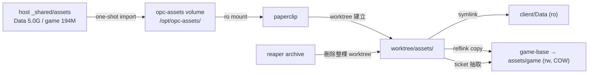

# Shared Game Assets Across Paperclip Worktrees — Design Spec

**日期**: 2026-11-18
**狀態**: draft, 待審
**範圍**: `opc-stack`（volume / CLI / entrypoint / import）＋ `champi-survivor`（manifest / .gitignore / 文件）

## 背景

`champi-survivor` 需要一份 5 GB 的遊戲客戶端素材（`assets/Data`，GRF）才能做畫面相關的驗證，抽取後的 `assets/game` 目前是 194 MB。這兩個目錄都不進版控；`assets/game` 會隨每個 ticket 的需求再抽更多檔案（地圖、角色、紙娃娃、特效），**不是固定內容**。

Paperclip 的 execution workspace 是 `git worktree`：

- worktree 只包含 tracked 檔案；`assets/` 不存在（實測 OPC-248 的 worktree 沒有 `assets/`）。
- 每個 ticket 一個 worktree，開 n 個 ticket 就會有 n 份 working copy。
- 直接複製素材進每個 worktree 會是 5 GB × n，而且 `assets` 目前**不在** `.gitignore`，一旦被放進去就會變成 untracked（詳見「清理」）。

宿主機已經有一半的機制 `~/champi-survivor-worktrees/_shared/assets`（`Data` 5.0 GB、`game` 194 MB、`evidence` 105 MB、`source` 3.2 MB，另有未使用的 `Data2026.rar` 4.2 GB）：每個 worktree 的 `assets/Data` 是 symlink，但 `assets/game` 是 194 MB 的實體複本。容器內沒有對應機制。

## 目標

1. Paperclip 的每個 `champi-survivor` worktree 都能取得唯讀的客戶端素材（`Data`），不必複製 5 GB。
2. 每個 ticket 都能在自己的 worktree 裡抽取新的 `assets/game` 內容，互不影響，且不需要改抽取工具。
3. **ticket 的 worktree 被 archive 時，抽取出來的資料一定跟著消失**；沒有第二個沒人清的資料池。
4. 不引入 sidecar、不 patch `upstream/paperclip`、不依賴 `setupCommand`（Paperclip 不執行它，已確認）。
5. 對其他專案可重用：換一個 manifest 即可，不在 CLI 裡寫死 `champi-survivor`。

## 非目標

- 不把 ticket 抽出來的素材 promote 回共享樣板（v1）。共享樣板只由 operator 重新 import。
- 不做 CI 的素材快取；CI 沒有 assets，asset-dependent 檢查要明確 skip。
- 不改 `tools/extract_*.py` 或 `vite.config.ts`。
- 不改 Paperclip 的 reaper/compaction 行為。

## 現況證據（2026-11-18 實測）

| 事實 | 證據 |
|---|---|
| worktree 是 linked worktree，`.git` 是檔案 | `git worktree list`；`.git` 內容指向主 repo 的 `.git/worktrees/<name>` |
| base ref 從 `origin/main` 開 | workspace operation log：`git worktree add -b OPC-248-... <path> origin/main` |
| Paperclip 不執行 `setupCommand` | `server/src/services/workspace-runtime.ts` 無執行路徑；只有 CRUD / portability 讀寫 |
| reaper 的 clean 判定是 `git status --porcelain --untracked-files=all` 為空 | `execution-workspaces.ts:1906` `workspaceDirty`；dirty 直接跳過 archive（`:3473`） |
| ignored 檔案不擋 `git worktree remove`，且會一起刪除 | scratch repo 實測：worktree 內 8 MB ignored 檔 → `git worktree remove` rc=0，目錄消失 |
| 未 ignored 的檔案會永久擋住 archive | OPC-245～248 的 `.claude/settings.local.json`（1 KB）造成 4 個 worktree 累積；清掉後 5 分鐘內全部 archive |
| compaction 只認固定名稱（`node_modules` `dist` `build` `target` …），`assets` 不在其中 | `server/src/services/workspace-compaction.ts` `REGENERABLE_WORKSPACE_DIR_NAMES` |
| archive 是唯一會刪整個 worktree 的路徑，需要 terminal tree + clean + merged + 冷卻 1 天 | `execution-workspaces.ts:3440-3500` |
| 宿主與 `/paperclip` volume 都是 btrfs；容器內 `cp --reflink=always` 成功 | `df -T`、`stat -f`、scratch 檔實測 rc=0（`du` 會高報，兩個 64 MB 檔顯示 128 MB，實際共享 extent） |
| `assets/` 目前不在 `.gitignore` | 宿主 repo `.gitignore` 沒有此項；`git check-ignore assets` rc=1 |

## 設計

### 原則

| 資料性質 | 機制 | 理由 |
|---|---|---|
| 不可變、唯讀（`Data` 客戶端、可選 `evidence`/`source`） | symlink 到 `/opt/opc-assets/<store>/...` | 5 GB 只需一份；唯讀掛載讓誤寫直接失敗 |
| 可變、per-ticket 衍生物（`assets/game`） | **COW 複本**（btrfs reflink，`cp -a --reflink=auto`） | 每個 ticket 可自由覆寫／新增；寫入不會回滲；磁碟成本≈變更量 |
| per-ticket 產物 | 留在 worktree 內、`assets/` 被 gitignore | archive 時整棵刪除，沒有第二個 GC 要維護 |

### 資料流



### Store 佈局

```
opc-assets (named volume, paperclip 以 :ro 掛在 /opt/opc-assets)
└── champi-survivor/                  # store key，由 manifest 指定
    ├── client/Data/                  # 5.0G 客戶端，唯讀
    ├── game-base/                    # 194M 抽取樣板，唯讀
    ├── evidence/                     # 105M，可選
    └── source/                       # 3.2M，可選
```

`Data2026.rar` 不進 volume（4.2 GB，只在大檔解壓時用）。

### Repo 端的 manifest（進版控）

`.paperclip-assets.json`（repo 根目錄）：

```json
{
  "version": 1,
  "store": "champi-survivor",
  "entries": [
    { "target": "assets/Data",  "source": "client/Data", "mode": "symlink" },
    { "target": "assets/game",  "source": "game-base",  "mode": "reflink-copy" }
  ]
}
```

- `target` 必須是相對路徑、不得逃出 worktree 根目錄。
- `source` 是 store 內的相對路徑。
- `mode`：`symlink`（唯讀共用）或 `reflink-copy`（可寫 COW）。
- 可選 `evidence`/`source` 以 `symlink` 加入；v1 範例只放 `Data` + `game`。
- 同一 target 只允許一個 entry；未知欄位／版本 → 拒絕。

### CLI：`opc-assets`

位置：`patches/paperclip/opc-assets/`，image 內 `/usr/local/bin/opc-assets`。Node（image 已有），只用 stdlib + `child_process`。

| 指令 | 行為 |
|---|---|
| `opc-assets init [--quiet]` | 依 manifest 建立 target；已符合則跳過；`--quiet` 只輸出警告 |
| `opc-assets status [--json]` | 每個 entry 的狀態：`ok` / `missing` / `wrong-target` / `not-a-symlink` / `store-missing` / `not-ignored` |
| `opc-assets check` | 驗 manifest、store 存在、每個 target 被 gitignore；不安全就 exit 2 |
| `opc-assets install-hook [--cwd <clone>]` | 在 project clone 的 `.git/hooks/post-checkout` 安裝掛鉤（idempotent） |

`init` 的安全規則（fail closed）：

1. `git check-ignore -q <target>` 必須成立；不是 ignored 就**什麼都不建**，exit 2。這一條保證「放進去的東西清得掉」。
2. target 已存在：
   - symlink 且指向同一個 source → `ok`（idempotent）。
   - 其他任何形式（真目錄、真檔案、指向別處的 link）→ 拒絕，不覆蓋、不刪除。`--force` v1 不提供。
3. `reflink-copy`：`cp -a --reflink=auto <store>/<source> <target>`，完成後 `chmod -R u+w <target>`（樣板可能是唯讀）。`--reflink=auto` 在非 btrfs 上自動退回一般複製。
4. 缺 store → exit 1，只警告；agent 走「未驗證」路徑（見下）。
5. 在 target 旁邊用 `mkdir` 做一次性 lock，避免兩個 init 同時寫同一個 worktree。

Exit codes：`0` ok、`1` store missing、`2` unsafe / not ignored / invalid manifest、`3` 其他 IO 錯誤。

### 觸發

1. **主要：`post-checkout` hook**（標準做法；`git worktree add` 會執行它）。
   - 安裝在 project clone 的 `.git/hooks/post-checkout`；hooks 由所有 worktree 共用，所以一次覆蓋全部 ticket。
   - 掛鉤內容：

     ```sh
     #!/bin/sh
     [ -f .paperclip-assets.json ] || exit 0
     [ -f .git ] || exit 0            # 只處理 linked worktree
     command -v opc-assets >/dev/null 2>&1 || exit 0
     opc-assets init --quiet || true
     exit 0
     ```

   - 既有 hook 存在時：備份成 `post-checkout.pre-opc-assets`，新的 wrapper 依序執行舊 hook（傳 `"$@"`）再執行 ours；不吞掉舊行為。
   - 掛鉤永遠 exit 0：素材問題不能讓 `git worktree add` 失敗。

2. **安裝：entrypoint 掃描**（`patches/paperclip/opc-assets-hook-install.sh`，由 paperclip entrypoint 在背景執行，非致命）。
   - 掃 `<instance>/projects/<company>/<project>/<repo>`；看到 `.paperclip-assets.json` 就 `opc-assets install-hook`。
   - 每次開機重跑；project clone 被重建後會自動補回。
   - 新 project 若在開機後才建立，第一次由 agent 依 `AGENTS.md` 執行 `opc-assets init`（它也會 `install-hook`），之後自動。

3. **備援：repo 文件**。`champi-survivor` 的 `AGENTS.md` / `docs/agents/assets.md` 寫明：
   - 開工先 `opc-assets status`；`store-missing` 時不要嘗試自己解壓客戶端，照常做 code-level 驗證，並在 ticket 標明「視覺/素材相關未驗證」。
   - 抽取只寫 `assets/game`（worktree 內），**不准**寫 `/opt/opc-assets`。
   - 不要 commit `assets/`，不要把它複製到其他位置。

### Import（operator 一次性）

`scripts/import-assets.sh <store> <host-source> [--include client,game,evidence,source]`：

- 建立 `opc-assets` volume（若不存在）。
- 用 tar stream 匯入，避免 service 層 host mount：

  ```sh
  tar -C "$HOST_SRC" -cf - Data game | \
    docker run --rm -i -v opc-assets:/assets alpine:3 \
      sh -c 'mkdir -p /assets/<store> && tar -C /assets/<store> -xf -'
  ```

- 匯入後在 `/assets/<store>/.import.json` 寫來源路徑、時間、大小，作為 `status` 的檢查依據。
- 可重跑；`--force` 才覆蓋既有 store（預設拒絕）。
- 不匯入 `Data2026.rar`。

compose：

```yaml
services:
  paperclip:
    volumes:
      - opc-assets:/opt/opc-assets:ro
volumes:
  opc-assets: {}
```

`ro` 是機制性保證：ticket 不可能把資料寫回共享樣板。

### 清理（本設計的核心保證）

| 資料 | 誰刪 | 何時 |
|---|---|---|
| `worktree/assets/**`（含 ticket 新抽的） | reaper archive → `git worktree remove` | issue tree terminal + 已交付（merged / ancestry）+ clean + 冷卻 1 天 |
| `worktree/assets/**`（未合併 ticket） | 不會自動刪 | 合併、取消，或人工 `git worktree remove`（OPC-245 前例） |
| `opc-assets` | 不會自動刪 | 只有 operator 重新 import / 刪 volume |
| 共享樣板的新增 | 不可能 | volume 在 paperclip 內是 `:ro` |

「clean」的定義是 `git status --porcelain --untracked-files=all` 為空。`assets/` 被 ignore 所以不出現；`git worktree remove` 也不會因 ignored 檔而拒絕（已實測）。**因此「抽出來的東西清不掉」只可能發生在 ignore 規則缺失時**，而 `opc-assets init` 會在那一步直接拒絕。

`assets` 不在 compaction 的清單裡，所以 1 小時的 compaction 不會碰它；archive 才是刪除點。這是刻意的：抽取結果在 ticket 還活著時必須留著。

### Repo 端需要的改動（`champi-survivor`）

1. `.gitignore`：

   ```gitignore
   /assets
   .claude/settings.local.json
   ```

   用裸 `/assets`，**不要** `assets/`：結尾斜線只匹配目錄，若 `assets` 是 symlink 就不會被忽略（Claude Code 文件實測過的坑）。

2. `.paperclip-assets.json`：如上的 manifest。

3. `AGENTS.md` / `docs/agents/assets.md`：加入「素材共用」一節（store 路徑、`opc-assets status`、不准寫 store、缺 store 時的完成語意）。

4. 不改 `package.json` 的 `assets` script；operator 在自己的機器上仍可 `bun run assets`。

### 失敗模式

| 情況 | 行為 |
|---|---|
| store 未 import / volume 沒掛 | `init` exit 1；hook 靜默；agent 標「未驗證」；`typecheck`/`test`/`build` 照跑（不需要 assets） |
| `.gitignore` 沒 `/assets` | `init` exit 2，什麼都不建；這是刻意的 fail-closed |
| target 已存在（真目錄／別的 link） | 拒絕，不覆蓋；由人決定 |
| 非 btrfs | `--reflink=auto` 退回一般複製（194 MB/worktree）；功能不變 |
| 樣板檔案是唯讀 | 複製後 `chmod -R u+w` |
| 抽取工具寫 `manifest.json` | 寫在 COW 複本，不影響樣板或其他 ticket |
| 兩個 init 同時跑 | `mkdir` lock；重複執行 idempotent |
| `du` 看起來每 worktree 194 MB | btrfs 上 `du` 高報；共享 extent 不佔額外空間。需要時用 `btrfs filesystem du` / `compsize` 看 exclusive bytes |

## 不採用的方案

| 方案 | 為什麼不用 |
|---|---|
| 全部 symlink 農場（`git-worktree-share`、`worktree-link`、Claude Code `worktree.symlinkDirectories`、Orca `sharedDirectories`） | 適合不可變資料（`node_modules`、`.env`）。`assets/game` 每個 ticket 會新增/覆寫，symlink 會讓寫入回滲到所有 worktree；要安全就得引入 per-file link farm + publish 工具（Bazel/pnpm 級複雜度），不划算 |
| 共享 **可寫** store（rw volume） | 一個 ticket 的寫入對所有 ticket 可見、`git status` 仍是 clean（隱形）；`manifest.json` 併發覆寫；而且沒有任何自動回收路徑 |
| 每個 worktree 完整複製 194 MB | 功能正確，但 194 MB × n；btrfs 已能用 COW 幾乎免費，沒有理由付這筆 |
| host bind mount 素材目錄 | 違反不變量 6（service 無 host mount）；worktree 路徑動態，也無法逐個掛載 |
| DVC / git-annex | 4.5 GB 客戶端不可散佈、CI 也不能快取；還要引入新工具鏈。DVC 的 `cache.type symlink` 也還是同一個 symlink 問題 |

## 驗收

1. 在 scratch repo（`.paperclip-assets.json` + 假 store）：
   - `symlink` entry 建出正確 link；`reflink-copy` entry 建出可寫複本。
   - 重跑 `init` 不改變任何東西（idempotent）。
   - `.gitignore` 缺 target → exit 2，且檔案系統沒有新增任何東西。
   - target 已存在真目錄 → 拒絕，原內容不動。
   - `install-hook` 兩次結果相同；既有 hook 被保留並串接。
   - `git worktree add` 之後，hook 真的執行 `init`。
2. Paperclip 容器：
   - `opc-assets status` 在沒有 store 時回 `store-missing`；在匯入後回 `ok`。
   - 新 ticket 的 worktree 內 `assets/Data` 是 symlink、`assets/game` 是可寫 COW 複本；`git status` 為空。
   - ticket 內跑 `python3 tools/extract_assets.py --map <x>` 成功新增檔案；其他 worktree 不受影響。
   - archive 後 worktree 目錄（含 assets）消失（opt-in 的手動驗證，不進 gate）。
3. 既有 gate 不退化：`tests/audit-bootstrap.sh` 需要知道新的 one-shot（volume mount 是 ro、hook installer 存在）；`tests/connectivity.sh` 不受影響。

## 待決事項（實作前）

- `evidence/`、`source/` 是否要納入預設 manifest（目前設計為可選）。
- `game-base` 由誰、多久更新一次（v1 假設 operator 重新 import；不提供 promote）。
