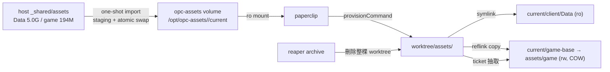

# Shared Game Assets Across Paperclip Worktrees — Design Spec

**日期**: 2026-11-18
**狀態**: draft, 待審
**範圍**: `opc-stack`（volume / CLI / import / compose）＋ `champi-survivor`（manifest / `.gitignore` / `scripts/provision-worktree.sh` / 文件）

## 背景

`champi-survivor` 需要一份 5 GB 的遊戲客戶端素材（`assets/Data`，GRF）才能做畫面相關的驗證，抽取後的 `assets/game` 目前是 194 MB。這兩個目錄都不進版控；`assets/game` 會隨每個 ticket 的需求再抽更多檔案（地圖、角色、紙娃娃、特效），**不是固定內容**。

Paperclip 的 execution workspace 是 `git worktree`：

- worktree 只包含 tracked 檔案；`assets/` 不存在（實測 OPC-248 的 worktree 沒有 `assets/`）。
- 每個 ticket 一個 worktree，開 n 個 ticket 就會有 n 份 working copy。
- 直接複製素材進每個 worktree 會是 5 GB × n，而且 `assets` 目前**不在** `.gitignore`，一旦被放進去就會變成 untracked（詳見「清理」）。

宿主機已經有一半的機制 `~/champi-survivor-worktrees/_shared/assets`（`Data` 5.0 GB、`game` 194 MB、`evidence` 105 MB、`source` 3.2 MB，另有未使用的 `Data2026.rar` 4.2 GB）：每個 worktree 的 `assets/Data` 是 symlink，但 `assets/game` 是 194 MB 的實體複本。容器內沒有對應機制。

## 目標

1. Paperclip 的每個 `champi-survivor` worktree 都能取得唯讀的客戶端素材（`Data`），不必複製 5 GB。
2. 每個 ticket 都能在自己的 worktree 裡抽取新的 `assets/game` 內容，互不影響，且不需要改抽取工具。
3. **ticket 的 worktree 被 archive 時，抽取出來的資料一定跟著消失**；沒有第二個沒人清的資料池。
4. 不引入 sidecar、不 patch `upstream/paperclip`、不改抽取工具。
5. 對其他專案可重用：換一個 manifest 與 provision script 即可，不在 CLI 裡寫死 `champi-survivor`。

## 非目標

- 不把 ticket 抽出來的素材 promote 回共享樣板（v1）。共享樣板只由 operator 重新 import。
- 不做 CI 的素材快取；CI 沒有 assets，asset-dependent 檢查要明確 skip。
- 不改 `tools/extract_*.py` 或 `vite.config.ts`。
- 不改 Paperclip 的 reaper/compaction 行為。
- 不覆蓋 project clone 本身（`instances/.../projects/<company>/<project>/<repo>`）的 cwd 執行；本設計只管 `git_worktree` 的 execution workspace。

## 現況證據（2026-11-18 實測）

| 事實 | 證據 |
|---|---|
| worktree 是 linked worktree，`.git` 是檔案 | `git worktree list`；`.git` 內容指向主 repo 的 `.git/worktrees/<name>` |
| base ref 從 `origin/main` 開 | workspace operation log：`git worktree add -b OPC-248-... <path> origin/main` |
| **Paperclip 有 worktree provision 指令，且 create 與 reuse 都會跑** | `workspace-runtime.ts:3010` `resolveWorkspaceProvisionCommand`；`provisionExecutionWorktree` 在 `:3487`（reuse）、`:3647`/`:3744`（create）、`:4011`（restoration）被呼叫 |
| provision 指令來源：`workspaceStrategy.provisionCommand`，否則 repo 的 `scripts/provision-worktree.sh` | `BUILTIN_WORKSPACE_PROVISION_COMMAND = "bash ./scripts/provision-worktree.sh"` |
| provision 以 worktree 為 cwd，並帶 `PAPERCLIP_WORKSPACE_CREATED=true/false` | `buildWorkspaceCommandEnv`；`created` 由呼叫端傳入 |
| provision 非零 exit 會讓該次 run 失敗；environment 路徑有 300s timeout | `runWorkspaceCommand` → `WorkspaceCommandExitError`；`environment-run-orchestrator.ts:530` `timeoutMs: 300_000` |
| Paperclip 不執行 `setupCommand` | `server/src/services/workspace-runtime.ts` 無執行路徑；只有 CRUD / portability 讀寫 |
| reaper 的 clean 判定是 `git status --porcelain --untracked-files=all` 為空 | `execution-workspaces.ts:1906` `workspaceDirty`；dirty 直接跳過 archive（`:3473`） |
| ignored 檔案不擋 `git worktree remove`，且會一起刪除 | scratch repo 實測：worktree 內 8 MB ignored 檔 → `git worktree remove` rc=0，目錄消失 |
| 未 ignored 的檔案會永久擋住 archive | OPC-245～248 的 `.claude/settings.local.json`（1 KB）造成 4 個 worktree 累積；清掉後 5 分鐘內全部 archive |
| compaction 只認固定名稱（`node_modules` `dist` `build` `target` …），`assets` 不在其中 | `server/src/services/workspace-compaction.ts` `REGENERABLE_WORKSPACE_DIR_NAMES` |
| archive 是唯一會刪整個 worktree 的路徑，需要 terminal tree + clean + merged + 冷卻 1 天 | `execution-workspaces.ts:3440-3500` |
| 宿主與 `/paperclip` volume 都是 btrfs；容器內 `cp --reflink=always` 成功 | `df -T`、`stat -f`、scratch 檔實測 rc=0（`du` 會高報，兩個 64 MB 檔顯示 128 MB，實際共享 extent） |
| `assets/` 目前不在 `.gitignore` | 宿主 repo `.gitignore` 沒有此項；`git check-ignore assets` rc=1 |

**這份設計的觸發機制因此改用 Paperclip 原生的 `provisionCommand`，不再需要 `post-checkout` hook、entrypoint 安裝器或 sidecar。** 這是 builder check 抓到的修正：只有 `setupCommand` 不執行，`provisionCommand` 會執行，而且連 **reused worktree** 都會跑。

## 設計

### 原則

| 資料性質 | 機制 | 理由 |
|---|---|---|
| 不可變、唯讀（`Data` 客戶端） | symlink 到 `/opt/opc-assets/<store>/current/client/Data` | 5 GB 只需一份；唯讀掛載讓誤寫直接失敗 |
| 可變、per-ticket 衍生物（`assets/game`） | **COW 複本**（btrfs reflink，`cp -a --reflink=auto`） | 每個 ticket 可自由覆寫／新增；寫入不會回滲；磁碟成本≈變更量 |
| per-ticket 產物 | 留在 worktree 內、`assets/` 被 gitignore | archive 時整棵刪除，沒有第二個 GC 要維護 |

### 資料流



### Store 佈局（版本化 + 原子切換）

```
opc-assets (named volume, paperclip 以 :ro 掛在 /opt/opc-assets)
└── champi-survivor/
    ├── current -> versions/2026-11-18T07-00-00Z     # 原子 swap
    ├── versions/
    │   ├── 2026-11-18T07-00-00Z/
    │   │   ├── .import.json        # 最後才寫，代表這次 import 完成
    │   │   ├── client/Data/        # 5.0G 客戶端，唯讀
    │   │   ├── game-base/          # 194M 抽取樣板
    │   │   ├── evidence/           # 105M，可選
    │   │   └── source/             # 3.2M，可選
    │   └── 2026-11-17T.../         # 上一個版本，operator GC 前保留
    └── .import.lock
```

- `Data2026.rar` 不進 volume（4.2 GB，只在大檔解壓時用）。
- worktree 的 symlink 一律指向 `.../<store>/current/...`，所以 import 換版後，**已存在的 symlink 會自動解析到新版本**，且切換是 `rename(2)` 的原子替換：讀者只會看到完整舊版或完整新版，不會看到半套。
- `game-base` 在 ticket 首次 `init` 時被複製（COW），之後即使 store 換版也不影響該 ticket；新 ticket 才拿新樣板。

### Repo 端的 manifest（進版控）

`.paperclip-assets.json`（repo 根目錄）：

```json
{
  "version": 1,
  "store": "champi-survivor",
  "entries": [
    { "target": "assets/Data", "source": "client/Data", "mode": "symlink" },
    { "target": "assets/game", "source": "game-base", "mode": "reflink-copy" }
  ]
}
```

- `target` 必須是相對路徑、不得逃出 worktree 根目錄。
- `source` 是 `current/` 內的相對路徑。
- `mode`：`symlink`（唯讀共用）或 `reflink-copy`（可寫 COW）。
- 同一 target 只允許一個 entry；未知欄位／版本 → 拒絕。
- `evidence` / `source` 不列入預設 manifest（作者的決定：目前沒有 ticket 需要；要的時候加一行 symlink entry 即可，成本 0）。

### CLI：`opc-assets`

位置：`patches/paperclip/opc-assets/`，image 內 `/usr/local/bin/opc-assets`。Node（image 已有），只用 stdlib + `child_process`。

| 指令 | 行為 |
|---|---|
| `opc-assets init [--quiet]` | 依 manifest 建立 target；已符合則跳過；`--quiet` 只輸出警告 |
| `opc-assets status [--json] [--verify]` | 每個 entry 的狀態：`ok` / `missing` / `wrong-target` / `not-a-symlink` / `store-missing` / `store-incomplete` / `not-ignored` / `not-worktree` |
| `opc-assets check` | 驗 manifest、store、gitignore；不安全就 exit 2 |
| `opc-assets import-verify` | 對 store 的 `.import.json` 做檔案數／bytes 驗證（慢，operator 用） |

`init` 的安全規則（fail closed）：

1. `git check-ignore -q <target>` 必須成立；不是 ignored 就**什麼都不建**，exit 2。這一條保證「放進去的東西清得掉」。
2. 只能在 linked worktree 執行（`.git` 是檔案）；在 project clone 直接 exit 0 並印 `not-worktree`（`status` 會回 `not-worktree`）。
3. target 已存在：
   - symlink 且指向同一個 source → `ok`（idempotent）。
   - 其他任何形式（真目錄、真檔案、指向別處的 link）→ 拒絕，不覆蓋、不刪除。`--force` v1 不提供。
4. `reflink-copy`：先複製到 `assets/.opc-assets-staging-<pid>`，完成後 `chmod -R u+w`，再 `rename` 成 target。中途失敗只留下 staging，下一次 `init` 會清掉自己的 stale staging 後重試；**不會留下半套 target**。若 target 是先前版本留下的真目錄，`init` 拒絕並在訊息中給出人工指令（`rm -rf assets/game`，它是 ignored 的衍生物）。
5. lock：`assets/.opc-assets-lock`（在 ignored 的 `assets/` 內，不會變成 untracked）。若 lock 存在且 PID 已死／超過 10 分鐘，視為 stale 並接管。
6. 缺 store → `init` 印警告、exit 0（素材不是每個 ticket 都需要，不能因此讓 run 失敗）；agent 走「未驗證」路徑（見下）。
7. store 不完整（沒有 `.import.json`）→ `store-incomplete`，同樣 warning + exit 0；不建立任何 link。

Exit codes（依指令）：

| 指令 | 0 | 1 | 2 | 3 |
|---|---|---|---|---|
| `init` | ok / 已符合 / store-missing（警告） | — | unsafe / not ignored / manifest invalid | IO 錯誤 |
| `check` | 全部 OK | store-missing / incomplete | unsafe / not ignored / manifest invalid | IO 錯誤 |
| `status` | 一律 0（狀態在輸出裡） | — | — | 內部錯誤 |

### 觸發：Paperclip 原生 provisionCommand

不需要 hook、不需要 entrypoint 安裝器：

1. `champi-survivor` 新增 `scripts/provision-worktree.sh`（tracked）：

   ```sh
   #!/bin/sh
   # Paperclip 在 create 與 reuse 時都會以 worktree 為 cwd 執行這支。
   # 缺 store 不讓 ticket 失敗；ignore 規則缺失才失敗（config bug 要大聲）。
   [ -f .paperclip-assets.json ] || exit 0
   command -v opc-assets >/dev/null 2>&1 || exit 0
   opc-assets init --quiet || exit $?
   exit 0
   ```

   Paperclip 的 `resolveWorkspaceProvisionCommand` 會自動採用它；要改路徑或加參數可在 project workspace 的 `workspaceStrategy.provisionCommand` 指定。

2. 行為契約：
   - **store 缺失**：`init` 印 `WARNING`、exit 0；run 繼續，agent 看到 log 並在 ticket 標「素材相關未驗證」。素材不是每個 ticket 都需要的東西，不該讓 code-only 的 ticket 失敗。
   - **not-ignored / manifest 壞掉**：exit 2 → provision 非零 → **run 失敗**，run log 會指出是哪個 target。這是設定錯誤，必須在第一次就修好，不能默默生出 dirty worktree。
   - **reused worktree**：`PAPERCLIP_WORKSPACE_CREATED=false`，同一個 `init` 對已存在的 target 是 no-op、只補 missing 的 entry（不需要額外旗標）。
   - 300s 內要完成：reflink 複製 194M 是秒級；非 btrfs 的一般複製也在數十秒內。

3. 既有的 worktree（部署前就存在）與 store 在 worktree 建立後才 import 的情況：`opc-assets init` 可手動重跑；對已存在的 target 是 no-op，對 missing 的 entry 會補。文件寫明這個補救指令。

### Import（operator 一次性，原子換版）

`scripts/import-assets.sh <store> <host-source> [--map ...]`：

- 解析 volume：`docker volume ls --filter label=com.docker.compose.project=<project> --filter label=com.docker.compose.volume=opc-assets`。找不到就報錯，請 operator 先 `docker compose up -d paperclip` 讓 compose 建立（避免 compose project prefix 不一致而匯入到孤兒 volume）。
- 預設映射（`--map` 可覆寫，格式 `<hostRel>=<storeRel>`）：

  | host（`<host-source>` 下） | store（`<store>/current/` 下） |
  |---|---|
  | `Data` | `client/Data` |
  | `game` | `game-base` |
  | `evidence` | `evidence`（只在 `--map` 指定時） |
  | `source` | `source`（只在 `--map` 指定時） |

  `Data2026.rar` 不在預設映射。

- 流程：
  1. 建立 `versions/<UTC timestamp>/`，用 tar stream 寫入（不經 host mount）：

     ```sh
     tar -C "$HOST_SRC" -cf - Data game | \
       docker run --rm -i -v "$VOLUME":/assets alpine:3 \
         sh -c 'mkdir -p "/assets/<store>/versions/<ts>" && tar -C "/assets/<store>/versions/<ts>" -xf -'
     ```

  2. 寫入 `versions/<ts>/.import.json`（**最後**才寫）：per-entry `{files, bytes}`、source path、時間。
  3. 原子切換：`ln -sfn versions/<ts> current.tmp && mv -T current.tmp current`。
  4. 保留上一個版本；`--prune-old` 才刪。
- 中途被殺：沒有 `.import.json` 的 version 目錄會被下次 import 清掉；`current` 不會被切換，live worktree 不受影響。
- 覆蓋既有 store 需要 `--force`（預設拒絕）；`--force` 也是走 staging + atomic swap，不做 in-place 覆寫。

### 清理（本設計的核心保證）

| 資料 | 誰刪 | 何時 |
|---|---|---|
| `worktree/assets/**`（含 ticket 新抽的） | reaper archive → `git worktree remove` | issue tree terminal + 已交付（merged / ancestry）+ clean + 冷卻 1 天 |
| `worktree/assets/**`（未合併 ticket） | 不會自動刪 | 合併、取消，或人工 `git worktree remove`（OPC-245 前例） |
| `opc-assets/versions/*` | 不會自動刪 | operator 重新 import / `--prune-old` / 刪 volume |
| 共享樣板的新增 | 不可能 | volume 在 paperclip 內是 `:ro`；`init` 只讀 |

「clean」的定義是 `git status --porcelain --untracked-files=all` 為空。`assets/` 被 ignore 所以不出現；`git worktree remove` 也不會因 ignored 檔而拒絕（已實測）。**因此「抽出來的東西清不掉」只可能發生在 ignore 規則缺失或 `assets` 沒被 ignore 時**，而 `opc-assets init` 會在那一步直接拒絕。

`assets` 不在 compaction 的清單裡，所以 1 小時的 compaction 不會碰它；archive 才是刪除點。這是刻意的：抽取結果在 ticket 還活著時必須留著。

### Repo 端需要的改動（`champi-survivor`）

1. `.gitignore`：

   ```gitignore
   /assets
   .claude/settings.local.json
   ```

   用裸 `/assets`，**不要** `assets/`：結尾斜線只匹配目錄，若 `assets` 是 symlink 就不會被忽略（Claude Code 文件實測過的坑）。

2. `.paperclip-assets.json`：如上的 manifest。

3. `scripts/provision-worktree.sh`：如上（記得 `chmod +x`；Paperclip 用 `bash` 執行，不看 executable bit，但保持可讀）。

4. `AGENTS.md` / `docs/agents/assets.md`：加入「素材共用」一節：
   - 開工先 `opc-assets status`；`store-missing` 時不要嘗試自己解壓客戶端，照常做 code-level 驗證，並在 ticket 標明「視覺/素材相關未驗證」。
   - 抽取只寫 `assets/game`（worktree 內），**不准**寫 `/opt/opc-assets`。
   - 不要 commit `assets/`，不要把它複製到其他位置。
   - 若 `status` 說 `missing`（例如 store 是後來才 import），跑 `opc-assets init`。

5. 不改 `package.json` 的 `assets` script；operator 在自己的機器上仍可 `bun run assets`。

### 失敗模式

| 情況 | 行為 |
|---|---|
| store 未 import / volume 沒掛 | `init` 警告 + exit 0；agent 標「未驗證」；`typecheck`/`test`/`build` 照跑 |
| `.gitignore` 沒 `/assets` | `init` exit 2 → provision 非零 → **run 失敗**，訊息指出 target |
| target 已存在真目錄（先前手動放進去） | 拒絕，不覆蓋；訊息給 `rm -rf assets/game`（ignored 衍生物） |
| 複製中途被殺 | 只留下 `assets/.opc-assets-staging-*`；下次 `init` 清掉後重試 |
| 非 btrfs | `--reflink=auto` 退回一般複製（194 MB/worktree）；功能不變 |
| 樣板檔案是唯讀 | 複製後 `chmod -R u+w` |
| 抽取工具寫 `manifest.json` | 寫在 COW 複本，不影響樣板或其他 ticket |
| 兩個 init 同時跑 | `assets/.opc-assets-lock`；stale lock 會被接管；重複執行 idempotent |
| import 時有 ticket 正在讀 | 換版是原子 symlink swap，讀者只看到完整舊版或完整新版 |
| `du` 看起來每 worktree 194 MB | btrfs 上 `du` 高報；共享 extent 不佔額外空間。需要時用 `btrfs filesystem du` / `compsize` 看 exclusive bytes |
| project clone 的 cwd 執行 | 不在本設計範圍；`status` 回 `not-worktree`，文件明講不要在那裡做素材驗證 |

## 不採用的方案

| 方案 | 為什麼不用 |
|---|---|
| `post-checkout` hook（git-worktree-share / worktree-link / Claude Code / Orca 的機制） | Paperclip 原生 `provisionCommand` 已覆蓋 create **與 reuse**，hook 反而漏掉 reuse 路徑，还要維護 hook 安裝器與既有 hook 串接 |
| 全部 symlink 農場 | 適合不可變資料。`assets/game` 每個 ticket 會新增/覆寫，symlink 會讓寫入回滲；要安全就得引入 per-file link farm + publish 工具（Bazel/pnpm 級複雜度） |
| 共享 **可寫** store（rw volume） | 一個 ticket 的寫入對所有 ticket 可見、`git status` 仍是 clean（隱形）；`manifest.json` 併發覆寫；而且沒有任何自動回收路徑 |
| 每個 worktree 完整複製 194 MB | 功能正確，但 194 MB × n；btrfs 已能用 COW 幾乎免費 |
| host bind mount 素材目錄 | 違反不變量 6（service 無 host mount）；worktree 路徑動態，也無法逐個掛載 |
| DVC / git-annex | 4.5 GB 客戶端不可散佈、CI 也不能快取；還要引入新工具鏈。DVC 的 `cache.type symlink` 也還是同一個 symlink 問題 |
| 用 `setupCommand` | Paperclip 只 CRUD 它，從不執行 |

## 驗收

1. 在 scratch repo（`.paperclip-assets.json` + 假 store + `scripts/provision-worktree.sh`）：
   - `symlink` entry 建出正確 link；`reflink-copy` entry 建出可寫複本。
   - 重跑 `init` 不改變任何東西（idempotent）。
   - `.gitignore` 缺 target → exit 2，且檔案系統沒有新增任何東西。
   - target 已存在真目錄 → 拒絕，原內容不動。
   - 模擬中斷：staging 目錄存在時再跑 `init`，會清掉 stale staging 並成功。
   - lock 存在但 PID 已死 → 接管。
   - `status --json` 的狀態集合正確；`not-worktree` 在 project clone 回報。
2. Paperclip 容器：
   - 沒有 store 時 `opc-assets status` 回 `store-missing`；provision script exit 0（run 不失敗）。
   - import 後，新 ticket 的 worktree 內 `assets/Data` 是 symlink、`assets/game` 是可寫 COW 複本；`git status` 為空。
   - ticket 內跑 `python3 tools/extract_assets.py --map <x>` 成功新增檔案；其他 worktree 不受影響。
   - 既有 worktree 用 `opc-assets init` 補；`PAPERCLIP_WORKSPACE_CREATED=false` 的 reuse 路徑也會補。
   - archive 後 worktree 目錄（含 assets）消失（opt-in 的手動驗證，不進 gate）。
3. import：
   - 匯入到 staging + 原子 swap；live worktree 的 symlink 在 swap 後解析到新版本。
   - 中途殺掉 import，`current` 不變，舊版本仍可用。
4. 既有 gate 不退化：`tests/audit-bootstrap.sh` 需要知道新的 volume（ro）與 provision script 的期望；`tests/connectivity.sh` 不受影響。

## 待決事項

- 無。`evidence`/`source` 預設不納入（需要時加 manifest entry）；`game-base` 只由完整重新 import 更新（v1 不做 promote）。這兩項都是作者的決定，builder 可直接照此規劃。
