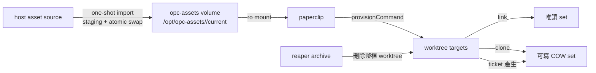

# Worktree Asset Sharing — Design Spec

**日期**: 2026-11-18
**狀態**: draft, 待審
**範圍**: `opc-stack`（volume / CLI / import / compose）＋ 任一需要非版控素材的專案（manifest / provision script / `.gitignore` / 文件）

## 背景

Paperclip 的 execution workspace 是 `git worktree`：只含 tracked 檔案，每個 ticket 一個 worktree。對需要**大型、不進版控素材**的專案（客戶端資料、模型權重、地圖包、字型、影片），這代表：

- 素材不存在於新 worktree；agent 得自己想辦法，或直接跳過相關驗證。
- 把素材複製進每個 worktree 是 `大小 × ticket 數`。
- 放進共享可寫目錄則是一個 ticket 的寫入會影響所有 ticket，`git status` 仍顯示乾淨（隱形），而且沒有任何自動回收路徑。

素材有兩種性質，必須分開處理：

| 性質 | 例子 | 需求 |
|---|---|---|
| 不可變（來源資料） | 客戶端資料、預訓練權重、原始素材庫 | 一份、唯讀、所有 worktree 共用 |
| 可變（per-ticket 衍生物） | 從來源抽出的檔案、轉檔結果、快取 | 每個 ticket 可自由新增／覆寫，互不影響，ticket 結束一起消失 |

這份設計提供一個通用機制；`champi-survivor` 的遊戲素材只是第一個使用者（見附錄）。

## 目標

1. 每個 worktree 都能取得不可變素材，不必複製整份。
2. 每個 ticket 都能產生自己的衍生物，互不影響，且不需要改專案既有的抽取／轉檔工具。
3. **worktree 被 archive 時，per-ticket 衍生物一定跟著消失**；沒有第二個沒人清的資料池。
4. 不引入 sidecar、不 patch `upstream/paperclip`、不依賴 `setupCommand`。
5. 機制本身與專案無關：換一份 manifest 與 provision script 就能給另一個專案用。

## 非目標

- 不把 per-ticket 衍生物 promote 回共享樣板（v1）。共享樣板只由 operator 重新 import。
- 不做 CI 的素材快取；CI 沒有素材，依賴素材的檢查要明確 skip。
- 不改專案的抽取／轉檔工具。
- 不改 Paperclip 的 reaper/compaction 行為。
- 不覆蓋 project clone 本身（`instances/.../projects/<company>/<project>/<repo>`）的 cwd 執行；本設計只管 `git_worktree` 的 execution workspace。

## 現況證據（2026-11-18 實測）

| 事實 | 證據 |
|---|---|
| worktree 是 linked worktree，`.git` 是檔案 | `git worktree list`；`.git` 內容指向主 repo 的 `.git/worktrees/<name>` |
| base ref 從 `origin/main` 開 | workspace operation log：`git worktree add -b <branch> <path> origin/main` |
| **Paperclip 有 worktree provision 指令，create 與 reuse 都會跑** | `workspace-runtime.ts:3010` `resolveWorkspaceProvisionCommand`；`provisionExecutionWorktree` 在 `:3487`（reuse）、`:3647`/`:3744`（create）、`:4011`（restoration）被呼叫 |
| provision 來源：`workspaceStrategy.provisionCommand`，否則 repo 的 `scripts/provision-worktree.sh` | `BUILTIN_WORKSPACE_PROVISION_COMMAND = "bash ./scripts/provision-worktree.sh"` |
| provision 以 worktree 為 cwd，帶 `PAPERCLIP_WORKSPACE_CREATED=true/false` | `buildWorkspaceCommandEnv` |
| provision 非零 exit 讓該次 run 失敗；environment 路徑有 300s timeout | `runWorkspaceCommand` → `WorkspaceCommandExitError`；`environment-run-orchestrator.ts:530` |
| Paperclip 不執行 `setupCommand` | 只有 CRUD / portability 讀寫 |
| reaper 的 clean 判定是 `git status --porcelain --untracked-files=all` 為空 | `execution-workspaces.ts:1906`、`:3473` |
| ignored 檔案不擋 `git worktree remove`，且會一起刪除 | scratch repo 實測：8 MB ignored 檔 → `git worktree remove` rc=0，目錄消失 |
| 未 ignored 的檔案會永久擋住 archive | 實測 `.claude/settings.local.json`（1 KB）讓 4 個 worktree 累積；清掉後立即 archive |
| compaction 只認固定名稱（`node_modules` `dist` `build` `target` …） | `workspace-compaction.ts` `REGENERABLE_WORKSPACE_DIR_NAMES` |
| archive 是唯一會刪整個 worktree 的路徑（terminal tree + clean + merged + 冷卻 1 天） | `execution-workspaces.ts:3440-3500` |
| 宿主與 `/paperclip` volume 都是 btrfs；容器內 `cp --reflink=always` 成功 | scratch 檔實測 rc=0；`du` 會高報，實際共享 extent |

## 設計

### 原則

| 資料性質 | 機制 | 理由 |
|---|---|---|
| 不可變 | `mode: "link"`：symlink 到 store | 一份；唯讀掛載讓誤寫直接失敗 |
| 可變（per-ticket 衍生物） | `mode: "clone"`：COW 複本（`cp -a --reflink=auto`） | 每 ticket 可自由寫；寫入不回滲；磁碟≈變更量 |
| per-ticket 產物 | 留在 worktree 內、target 被 gitignore | archive 時整棵刪除，沒有第二個 GC |

專案只透過一份 manifest 宣告「哪個 target 用哪種模式」，CLI 不含任何專案名稱。

### 資料流



### Store 佈局（版本化 + 原子切換）

```
opc-assets (named volume，paperclip 以 :ro 掛在 /opt/opc-assets)
└── <store>/
    ├── current -> versions/<id>         # 原子 swap
    ├── versions/
    │   ├── <id>/
    │   │   ├── .import.json             # 最後才寫，代表這次 import 完成
    │   │   ├── <set-a>/                 # 不可變 set
    │   │   └── <set-b>/                 # 可變 set 的樣板
    │   └── <previous-id>/               # 上一個版本，operator GC 前保留
    └── .import.lock
```

- worktree 的 symlink 指向 `<store>/current/...`；換版是原子 symlink swap，讀者只會看到完整舊版或完整新版。
- `clone` 在 ticket 首次 `init` 時複製；之後 store 換版不影響該 ticket，新 ticket 才拿新樣板。

### Manifest（進版控）

專案根目錄 `.worktree-assets.json`：

```json
{
  "version": 1,
  "store": "<store-key>",
  "entries": [
    { "target": "<worktree 相對路徑>", "source": "<store current 內的相對路徑>", "mode": "link" },
    { "target": "<worktree 相對路徑>", "source": "<store current 內的相對路徑>", "mode": "clone" }
  ]
}
```

規則：

- `target` 必須是相對路徑、不得逃出 worktree 根目錄；同一 target 只允許一個 entry。
- `source` 不得逃出 `current/`；不得是絕對路徑。
- `mode` 只有 `link` 與 `clone`；未知值或未知版本 → 拒絕。
- 專案自己的 `.gitignore` 必須涵蓋每個 target；CLI 會驗證（見下）。

### CLI：`worktree-assets`

位置：`patches/paperclip/worktree-assets/`，image 內 `/usr/local/bin/worktree-assets`。Node（image 已有），只用 stdlib + `child_process`；預設 store root 是 `/opt/opc-assets`，可用 `WORKTREE_ASSETS_ROOT` 覆寫（測試用）。

| 指令 | 行為 |
|---|---|
| `worktree-assets init [--quiet]` | 依 manifest 建立 target；已符合則跳過 |
| `worktree-assets status [--json]` | 每個 entry 的狀態（見下） |
| `worktree-assets check` | 驗 manifest、store、gitignore；不安全就 exit 2 |
| `worktree-assets import-verify` | 對 `.import.json` 做檔案數／bytes 驗證（慢，operator 用） |

狀態集合：`ok` / `missing` / `wrong-target` / `not-a-link` / `store-missing` / `store-incomplete` / `not-ignored` / `not-worktree`。

`init` 的安全規則（fail closed）：

1. `git check-ignore -q <target>` 必須成立；不是 ignored 就**什麼都不建**，exit 2。這是「放進去的東西清得掉」的保證。
2. 只能在 linked worktree 執行（`.git` 是檔案）；在 project clone 直接 exit 0 並印 `not-worktree`。
3. target 已存在：
   - `link`：已是同一個 source 的 symlink → `ok`；其他形式 → 拒絕，不覆蓋、不刪除。
   - `clone`：已存在 → `ok`（不重建）；其他形式 → 拒絕。
4. `clone` 先複製到 `<parent>/.worktree-assets-staging-<pid>`，完成後 `chmod -R u+w`，再 `rename` 成 target。中途失敗只留 staging；下次 `init` 清掉自己的 stale staging 後重試，**不會留下半套 target**。
5. lock 檔放在 target 的父目錄內（已被 ignore 的樹裡，例如 `assets/.worktree-assets-lock`），不會變成 untracked；stale lock（PID 已死或超過 10 分鐘）可接管。
6. store 缺 or 不完整（無 `.import.json`）：warning + exit 0，不建立任何 link。素材不是每個 ticket 都需要，不能因此讓 run 失敗。
7. `--force` 不提供；target 衝突一律交人處理（衍生物可安全重建，但 CLI 不替人決定）。

Exit codes（依指令）：

| 指令 | 0 | 1 | 2 | 3 |
|---|---|---|---|---|
| `init` | ok / 已符合 / store-missing（警告） | — | unsafe / not ignored / manifest invalid | IO 錯誤 |
| `check` | 全部 OK | store-missing / incomplete | unsafe / not ignored / manifest invalid | IO 錯誤 |
| `status` | 一律 0（狀態在輸出裡） | — | — | 內部錯誤 |

### 觸發：Paperclip 原生 provisionCommand

不需要 hook、不需要 sidecar、不需要 entrypoint 安裝器：

1. 專案新增 `scripts/provision-worktree.sh`（tracked）：

   ```sh
   #!/bin/sh
   # Paperclip 在 create 與 reuse 時都會以 worktree 為 cwd 執行這支。
   # 缺 store 不讓 ticket 失敗；ignore 規則缺失才失敗（config bug 要大聲）。
   [ -f .worktree-assets.json ] || exit 0
   command -v worktree-assets >/dev/null 2>&1 || exit 0
   worktree-assets init --quiet || exit $?
   exit 0
   ```

   Paperclip 的 `resolveWorkspaceProvisionCommand` 會自動採用它；要改路徑或加參數可設 `workspaceStrategy.provisionCommand`。

2. 行為契約：
   - **store 缺失**：`init` warning + 0；run 繼續，agent 在 ticket 標「素材相關未驗證」。
   - **not-ignored / manifest 壞掉**：exit 2 → provision 非零 → **run 失敗**，訊息指出 target。
   - **reused worktree**：`init` 對已存在 target 是 no-op、只補 missing 的 entry。
   - 300s 內完成：clone 是秒級；非 btrfs 的一般複製也在數十秒內。

3. 既有 worktree 或 store 在 worktree 建立後才 import：手動跑 `worktree-assets init`（對已存在 target 是 no-op）。

### Import（operator，原子換版）

`scripts/import-assets.sh <store> <host-source> --map <hostRel>=<setRel> [--map ...] [--force] [--prune-old]`：

- 沒有隱含映射；`--map` 必須明確（避免把不相關的目錄匯進 store）。`--map` 可重複。
- 解析 volume：`docker volume ls --filter label=com.docker.compose.project=<project> --filter label=com.docker.compose.volume=opc-assets`；找不到就報錯，請先 `docker compose up -d paperclip` 讓 compose 建立（避免 compose project prefix 不一致而匯入孤兒 volume）。
- 流程：
  1. 建立 `versions/<UTC timestamp>/`，用 tar stream 寫入（不經 host mount）：`tar -C "$HOST_SRC" -cf - <hostRel> | docker run --rm -i -v "$VOLUME":/assets alpine:3 sh -c 'mkdir -p ... && tar -C ... -xf -'`。
  2. 寫 `.import.json`（**最後**）：per-set `{files, bytes}`、來源、時間。
  3. 原子切換 `current`：先建暫存 symlink，再 `rename(2)` 取代（GNU `mv -T`）。
  4. 預設保留上一個版本；`--prune-old` 才刪。
- 中途被殺：沒有 `.import.json` 的 version 目錄會被下次 import 清掉；`current` 不會切換，live worktree 不受影響。
- `--force` 也是 staged + atomic swap，不做 in-place 覆寫。

### 清理

| 資料 | 誰刪 | 何時 |
|---|---|---|
| `worktree/<target>`（含 ticket 產生的） | reaper archive → `git worktree remove` | issue tree terminal + 已交付 + clean + 冷卻 1 天 |
| `worktree/<target>`（未合併 ticket） | 不會自動刪 | 合併、取消，或人工 `git worktree remove` |
| `opc-assets/versions/*` | 不會自動刪 | operator 重新 import / `--prune-old` / 刪 volume |
| 共享樣板的新增 | 不可能 | volume 在 paperclip 內是 `:ro` |

「clean」= `git status --porcelain --untracked-files=all` 為空。target 被 ignore 所以不出現；`git worktree remove` 不會因 ignored 檔拒絕（實測）。因此「產生的東西清不掉」只可能發生在 ignore 規則缺失時，而 `init` 會直接拒絕。

target 不在 compaction 的固定名稱清單裡，所以 compaction 不碰它；archive 才是刪除點。

### 專案端 checklist

1. `.gitignore` 加入每個 target 的**裸路徑**（例：`/assets`，不要 `assets/`——結尾斜線只匹配目錄，symlink 是檔案，不會被忽略）。
2. `.worktree-assets.json`。
3. `scripts/provision-worktree.sh`。
4. `AGENTS.md` / 專案文件：
   - 開工先 `worktree-assets status`；`store-missing` 時不要自行取得來源資料，照常做 code-level 驗證並標明未驗證項。
   - 衍生物只寫在 worktree 的 target 內，不准寫 store。
   - 不要 commit target，不要複製到其他位置。

### 失敗模式

| 情況 | 行為 |
|---|---|
| store 未 import / volume 沒掛 | warning + exit 0；agent 標「未驗證」 |
| `.gitignore` 缺 target | exit 2 → run 失敗，訊息指出 target |
| target 已存在真目錄／別的 link | 拒絕，不覆蓋；訊息給人工指令 |
| clone 中途被殺 | 只留 staging；下次 init 清掉重試 |
| 非 btrfs | `--reflink=auto` 退回一般複製；功能不變 |
| 樣板是唯讀 | 複製後 `chmod -R u+w` |
| 專案工具改寫 target 內的 manifest/index | 寫在 COW 複本，不影響樣板 |
| 兩個 init 同時跑 | lock + stale 接管；idempotent |
| import 時有 ticket 正在讀 | 原子 symlink swap，只看到完整舊版或新版 |
| `du` 看起來每個 worktree 都佔滿 | btrfs `du` 高報；用 `btrfs filesystem du` / `compsize` 看 exclusive bytes |
| project clone 的 cwd 執行 | 不在本設計範圍；`status` 回 `not-worktree` |

## 不採用的方案

| 方案 | 為什麼不用 |
|---|---|
| `post-checkout` hook（git-worktree-share / worktree-link / Claude Code / Orca 的機制） | Paperclip 原生 `provisionCommand` 已覆蓋 create 與 reuse；hook 反而漏掉 reuse，還要維護安裝器與既有 hook 串接 |
| 全部 symlink 農場 | 適合不可變資料；可變 set 的寫入會回滲，要安全就得做 per-file link farm + publish 工具 |
| 共享可寫 store | 寫入對所有 ticket 可見且隱形；index 併發覆寫；沒有自動回收 |
| 每個 worktree 完整複製 | 大小 × n；btrfs 已能 COW 幾乎免費 |
| host bind mount | 違反不變量 6（service 無 host mount）；worktree 路徑動態 |
| DVC / git-annex | 大型來源資料不可散佈、CI 不能快取；還要引入新工具鏈 |
| `setupCommand` | Paperclip 只 CRUD，從不執行 |

## 驗收

1. Scratch repo（manifest + 假 store + provision script）：
   - `link` 建出正確 symlink；`clone` 建出可寫複本。
   - 重跑 `init` 不改變任何東西。
   - `.gitignore` 缺 target → exit 2，檔案系統沒有新增任何東西。
   - target 已存在 → 拒絕，原內容不動。
   - 中斷後 staging 被清掉並重試成功；stale lock 被接管。
   - `status --json` 狀態集合正確；project clone 回 `not-worktree`。
2. Paperclip 容器：
   - 無 store：`status` = `store-missing`，provision exit 0。
   - import 後：新 worktree 的 link/clone 正確，`git status` 為空。
   - ticket 內在 clone target 新增檔案成功；其他 worktree 不受影響。
   - reuse 路徑（`PAPERCLIP_WORKSPACE_CREATED=false`）會補 missing entry。
   - archive 後 target 隨 worktree 消失（opt-in 手動驗證，不進 gate）。
3. import：staging + atomic swap；中途殺掉不影響 `current`。
4. 既有 gate 不退化：`tests/audit-bootstrap.sh` 知道新 volume（ro）與 provision script 的期望；`tests/connectivity.sh` 不受影響。

## 待決事項

- 無。Import 映射由 operator 明確提供；可變 set 的樣板只由完整重新 import 更新（v1 不做 promote）。這是作者的決定。

## 附錄：`champi-survivor`（第一個使用者，不是機制的一部分）

| host（`~/champi-survivor-worktrees/_shared/assets`） | store `<store>=champi-survivor` | 大小 |
|---|---|---|
| `Data` | `client/Data`（`link`） | 5.0 GB |
| `game` | `derived/game-base`（`clone`） | 194 MB |
| `evidence` | 需要時再 `--map` | 105 MB |
| `source` | 需要時再 `--map` | 3.2 MB |
| `Data2026.rar` | 不匯入 | 4.2 GB |

```json
{
  "version": 1,
  "store": "champi-survivor",
  "entries": [
    { "target": "assets/Data", "source": "client/Data", "mode": "link" },
    { "target": "assets/game", "source": "derived/game-base", "mode": "clone" }
  ]
}
```

- `.gitignore` 加 `/assets`（裸路徑）。
- `assets/game` 每個 ticket 會再抽新檔案，所以是 `clone` 而不是 `link`；`assets/Data` 唯讀，所以是 `link`。
- 抽取工具照舊寫 `assets/game`；寫入只落在該 ticket 的 COW 複本。
